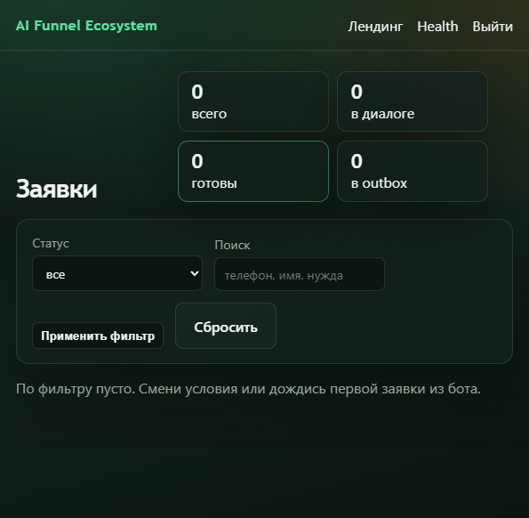
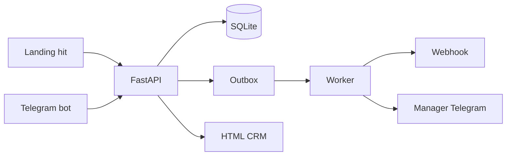

# AI Funnel Ecosystem

Воронка лидов → Telegram AI-бот → mini-CRM с outbox-воркером. Для агентств и соло, кому нужен один стек от хита на лендинге до менеджера в Telegram.



## Возможности

- Лендинг с hit в воронку и диалог `/api/chat`
- Telegram-бот с квалификацией лида и уведомлением менеджеру
- Mini-CRM: фильтры, заметки, timeline, soft-delete, CSV
- Workspace + managers, dedupe по телефону
- Outbox: webhook + Telegram notify; AI mock или OpenAI-compatible
- Auth (`X-CRM-Token` / JWT), rate-limit, `/health` + `/ready`, `/metrics`

## Архитектура



## Стек

Python 3.12 · FastAPI · SQLAlchemy async · SQLite · aiogram 3 · Alembic · Redis (optional) · Docker

## Запуск

```bash
git clone https://github.com/blessed-bless/ai-funnel-ecosystem.git
cd ai-funnel-ecosystem
python -m venv .venv && source .venv/bin/activate   # Windows: .venv\Scripts\activate
pip install -e ".[dev]"
cp .env.example .env && mkdir -p data
aifunnel-api
```

CRM: http://127.0.0.1:8080/crm/login · логин из `.env.example`: `admin` / `admin-change-me`.

Отдельно: `aifunnel-worker`, `aifunnel-bot`. Docker: `docker compose up --build api worker`.

## Конфигурация

| Переменная | Назначение |
| --- | --- |
| `APP_NAME` / `APP_ENV` / `LOG_LEVEL` | Имя, окружение, уровень логов |
| `DATABASE_URL` | Async SQLAlchemy URL |
| `API_HOST` / `API_PORT` / `API_PUBLIC_URL` | Bind и публичный URL |
| `CORS_ORIGINS` | CORS |
| `CRM_API_TOKEN` | Токен `X-CRM-Token` |
| `JWT_SECRET` / `JWT_EXPIRE_MINUTES` | JWT для CRM |
| `ADMIN_USERNAME` / `ADMIN_PASSWORD` | Логин HTML CRM |
| `RATE_LIMIT_PER_MINUTE` / `CHAT_RATE_LIMIT_PER_MINUTE` | Лимиты |
| `REDIS_URL` | Общий rate-limit (пусто → memory) |
| `WEBHOOK_URL` / `WEBHOOK_SECRET` / `WEBHOOK_TIMEOUT_SECONDS` | Исходящие webhook |
| `CRM_COOKIE_NAME` / `CRM_PROTECT_HTML` | Cookie-сессия CRM |
| `TELEGRAM_BOT_TOKEN` / `TELEGRAM_BOT_USERNAME` | Бот |
| `TELEGRAM_MANAGER_URL` / `TELEGRAM_MANAGER_CHAT_ID` | Notify менеджеру |
| `AI_PROVIDER` / `AI_API_KEY` / `AI_BASE_URL` / `AI_MODEL` | AI |
| `AI_MAX_RETRIES` / `AI_CIRCUIT_*` | Retry / circuit breaker |
| `FUNNEL_DEFAULT_SOURCE` / `READY_REQUIRE_DB` | Funnel / readiness |

Полный список — в `.env.example`.

## Автор

Богдан Щербинин ([blessed-bless](https://github.com/blessed-bless))

MIT.
