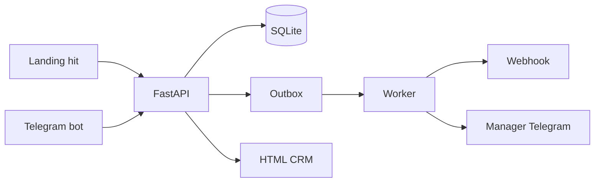

# AI Funnel Ecosystem

Воронка лидов → Telegram AI-бот → mini-CRM с outbox-воркером. Для агентств и соло, кому нужен один стек от хита до менеджера.

{{скриншот}}

## Возможности

- Лендинг с hit в воронку и диалог `/api/chat`
- Telegram-бот с квалификацией лида и уведомлением менеджеру
- Mini-CRM: фильтры, заметки, timeline, soft-delete, CSV import/export
- Workspace + managers, назначение менеджера, dedupe по телефону
- Outbox: webhook + Telegram notify; AI mock или OpenAI-compatible с retry/circuit breaker
- Auth (`X-CRM-Token` / JWT), rate-limit, `/health` + `/ready`, Prometheus `/metrics`

## Архитектура



## Стек

Python 3.12 · FastAPI · SQLAlchemy async · SQLite · aiogram 3 · Alembic · Redis (optional) · Docker

## Запуск

```bash
python -m venv .venv
# Windows: .venv\Scripts\activate
source .venv/bin/activate
pip install -e ".[dev]"
cp .env.example .env   # Windows: copy .env.example .env
mkdir -p data
make run               # или aifunnel-api
```

Отдельно: `aifunnel-worker`, `aifunnel-bot`. Docker: `docker compose up --build api worker`.

Миграции: `alembic upgrade head` (на старте API также `create_all` + лёгкий ALTER для старых SQLite).

Тесты и стиль: `make test`, `make lint`, `make fmt`.

## Конфиг

| Переменная | Назначение |
| --- | --- |
| `DATABASE_URL` | Async SQLAlchemy URL (по умолчанию SQLite в `./data`) |
| `CRM_API_TOKEN` | Токен для `X-CRM-Token` |
| `JWT_SECRET` / `ADMIN_*` | Логин HTML CRM и Bearer JWT |
| `REDIS_URL` | Общий rate-limit; пусто → in-memory |
| `WEBHOOK_URL` / `WEBHOOK_SECRET` | Исходящие события из outbox |
| `TELEGRAM_BOT_TOKEN` | Токен бота |
| `TELEGRAM_MANAGER_CHAT_ID` | Fallback chat для notify |
| `AI_PROVIDER` | `mock` или openai-compatible |
| `AI_API_KEY` / `AI_BASE_URL` / `AI_MODEL` | Внешний AI |
| `API_HOST` / `API_PORT` | Bind API |

Полный список — в `.env.example`.

## Автор

Богдан Щербинин ([blessed-bless](https://github.com/blessed-bless))

MIT.
